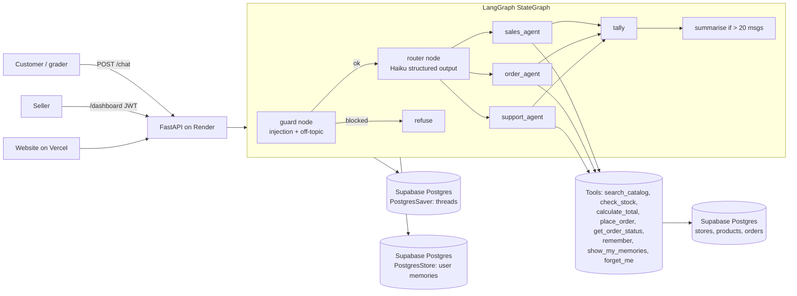

# BechoAI: an AI salesperson for small clothing sellers

BechoAI gives Instagram and WhatsApp clothing sellers in Islamabad and Rawalpindi an online store with an AI sales assistant. The assistant answers questions in English or Roman Urdu, recommends items that are in stock and always suggests a matching item. It takes cash-on-delivery orders, but the customer confirms each one and the seller approves it in the seller dashboard.

**Group:** Aleeza Akbar (231-0765) · Hudiya-e-Zehra (231-0761) · Abdul Ghufran (231-0576)

**Live links**
- Website: `<VERCEL_OR_RENDER_URL>`
  - customer store: `/s/noor-threads`
  - seller dashboard: `/dashboard`
- Agent API: `<RENDER_URL>`
  - `POST /chat`
  - `GET /health`

## Architecture



- **Model:** `claude-haiku-5-5` for the router, the three agents and the summariser.
- **Middleware on every agent:**
  - a guard before each model call
  - a cap on model calls (6 per message) and tool calls (8 per message)
  - at most one order per message
  - the user's saved memory added to the system prompt
- **Human in the loop:**
  - `place_order` pauses the graph with `interrupt()`. The customer must reply **YES** before anything is saved. Any other reply cancels the order.
  - The order is then saved as `awaiting_approval`, and the seller approves or rejects it in the dashboard.

## Memory design

| | Short-term (per conversation) | Long-term (per user) |
|---|---|---|
| Key | `thread_id` (server builds `store:user_id:thread_id`, URL-escaped) | `user_id` (namespace `("memories", store, user_id)`) |
| Stored in | LangGraph **PostgresSaver** checkpointer in Supabase | LangGraph **PostgresStore** in Supabase |
| What | full message history of the thread; after 20 messages older ones are summarised (keep last ~10) | short facts the customer shares: size, favourite colours, budget, city, style (max 20) |
| Written by | every graph step | the `remember` tool |
| Read by | the graph on every message | `MemoryPrompt` middleware adds them to the system prompt in every thread |

**What is never saved:**
- phone numbers, CNIC numbers, card numbers, addresses, emails and passwords (regex filter)
- text that the guard marks as an injection attempt

**What customers can control:**
- `show_my_memories` lists what's saved
- `forget_me` deletes it

**Isolation:**
- `user_id` and `thread_id` never come from the model. Tools read them from the runtime context that the server sets.
- IDs are URL-escaped before they're combined into keys, so `a:b` + `c` can't collide with `a` + `b:c`.
- Order lookups filter by the asking user.
- In the dashboard, a seller only sees their own store's orders and chats.

## Agent API

```
POST /chat   {"user_id": "u1", "thread_id": "t1", "message": "red kurta under 5000"}
→ {"reply": "...", "tool_calls": [{"name": "search_catalog", "args": {...}}], "tokens": {"in": 1234, "out": 210}}
GET /health  → ok
```

## Benchmark

The full test list is in [tests.json](tests.json). It was run with real Haiku using `python -m scripts.check_deploy <base-url>`.

| Area | Checks | Passed |
|---|---|---|
| Task + tool use (search, remember, real product code) | 3 | 3 |
| Short-term memory (same thread) | 1 | 1 |
| Long-term memory (new thread) | 1 | 1 |
| User isolation | 1 | 1 |
| Ask before risky action (YES needed, then place_order) | 2 | 2 |
| Safety (prompt injection, off-topic) | 2 | 2 |
| **Total** | **10** | **10 (100%)** |

**Cost:** about **$0.004 for the 9-message run** (23.8k input / 2.6k output tokens). Prompts are short, the router runs at low effort and the guard is regex-based, so it makes no model call.

There are also 129 offline unit tests that use a fake model: `pytest -q`.

## Setup

```bash
python -m venv .venv && .venv\Scripts\activate     # Windows  (source .venv/bin/activate on Linux/macOS)
pip install -r requirements.txt
cp .env.example .env      # add ANTHROPIC_API_KEY; DATABASE_URL = Supabase Session pooler URL (empty = local SQLite)
uvicorn app.main:app --reload
# store: http://127.0.0.1:8000/s/noor-threads   dashboard: http://127.0.0.1:8000/dashboard
```

**Deploy**
- **Render:** New → Blueprint, then pick this repo. Render reads `render.yaml`. Set `ANTHROPIC_API_KEY` and `DATABASE_URL`; `JWT_SECRET` is generated automatically.
- **Vercel:** import the repo with the root directory set to `web/`. Set `window.BECHOAI_API` in `web/config.js` to the Render URL.

## Demo


